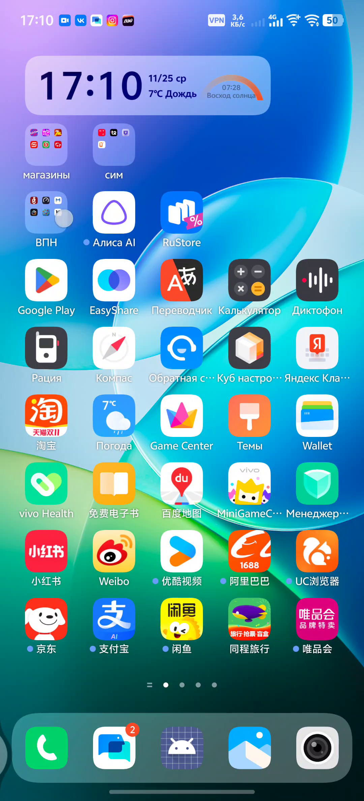
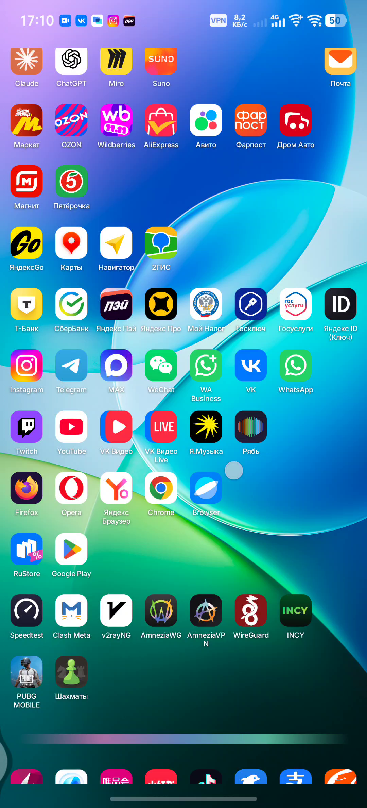
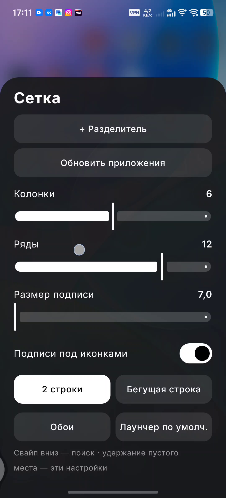
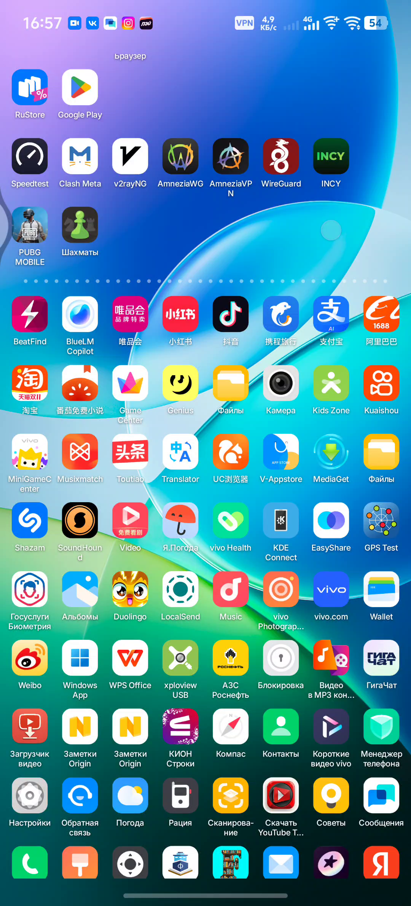
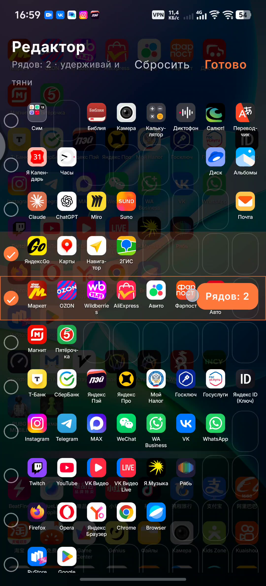

# Сетка — лаунчер для Android

Стоковый лаунчер Vivo — максимум 5×9 и куча рабочих столов. Бесило. Собрал свой.

**Все приложения на одном экране**, каждая иконка подписана, сетка любого размера, экран делится разделителями на блоки, блоки таскаются целиком.

Я не программист. Сделал с Claude, под себя. Бесплатно.

## Что умеет

- Сетка любого размера: колонки и ряды ползунками
- Подписи под всеми иконками: в две строки или бегущей строкой
- Иконки остаются ровно там, куда их бросил, пустые клетки не схлопываются
- Разделители с названием делят экран на блоки; блок перетаскивается целиком
- У блока: убрать пустые места, отсортировать по алфавиту
- Свайп вниз — поиск, удержание пустого места — настройки

| Стоковый Vivo | Сетка | Настройки |
|---|---|---|
|  |  |  |

| Разделители | Редактор блоков |
|---|---|
|  |  |

## Установка

Готовый `.apk` — во вкладке **Releases** (справа).

Или собрать самому:
1. Android Studio → Open → папка проекта, дождаться Gradle Sync.
2. Телефон по кабелю (отладка по USB включена) → зелёная кнопка Run.
3. На телефоне: Настройки → Приложения → Приложения по умолчанию → Рабочий стол → «Сетка». Или в лаунчере: удержание пустого места → «Лаунчер по умолч.».

**Жесты:** тап — открыть; удержание и тащить — переставить, бросить на иконку = папка; удержание без движения — меню; свайп вниз — поиск; удержание пустого места — настройки. Вернуть родной лаунчер: тот же пункт настроек → «Рабочий стол vivo».

---

Nikita Metod · Telegram: [t.me/nikitametod](https://t.me/nikitametod)
